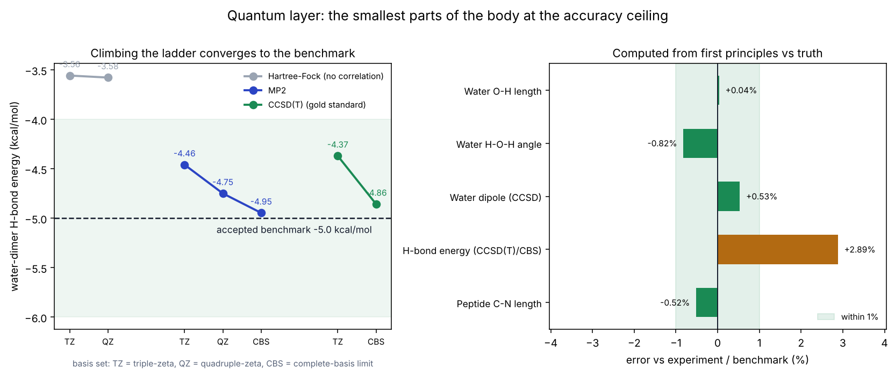

# The accuracy ladder

The goal: simulate the body at the highest accuracy physics allows, starting
from the smallest real pieces and proving each one correct before scaling up.

Accuracy in molecular simulation is a ladder. Each rung is a more complete
treatment of the physics, slower than the last, and each is validated against an
**independent authority** — an independent engine, an exact analytic result, or a
high-level quantum reference / experiment. We build from the top (most accurate,
smallest system) downward to the approximations that let us reach larger systems.

| Rung | Physics | Where it's exact | Validated against | Status |
|---|---|---|---|---|
| 5 | **Coupled cluster, CCSD(T)/CBS** | the electrons themselves (the "gold standard" of chemistry) | experiment + accepted benchmarks | **done** |
| 4 | **QM/MM** | quantum region exact; environment as classical field | classical electrostatics limit + finite-difference forces | **done** |
| 3 | **Explicit-solvent MD + Ewald/PME** | every atom, exact long-range electrostatics | independent engine (OpenMM), to 1e-11..1e-13 | **built** |
| 2 | **Free energy (TI/MBAR)** | rigorous thermodynamics of binding | exact analytic (Born) + experiment | planned |
| 1 | **Implicit-solvent MD** | fast approximate dynamics | independent engine (OpenMM), ~1e-14 | done (v0.1) |

This document covers the top two rungs, which are built and validated. `vh.quantum`.

## Why start at the top, on the smallest parts

A cell has ~10¹⁴ atoms; quantum methods scale steeply (CCSD(T) as N⁷), so a cell
is out of reach of this rung by an astronomical margin (and a whole body far more
so — see `feasibility.md`). But the *parts the body is built from* — water, the
peptide bond, amino acids — are small enough to treat at the true accuracy
ceiling. So we prove the physics there, exactly, and carry it upward through
QM/MM and force fields. "Molecular accuracy" is **defined** at this rung, not
approximated.

## Rung 5 — the accuracy ceiling (CCSD(T) at the complete-basis limit)

CCSD(T)/CBS is what cheaper methods, force fields and even some experiments are
calibrated against. We computed the smallest real pieces of the body from first
principles — no fitting to experiment — with PySCF, via `vh.quantum`.

### Water — ~60% of the body

Geometry optimized at MP2/cc-pVTZ; dipole at CCSD/aug-cc-pVTZ.

| Property | Computed | Experiment | Error |
|---|---|---|---|
| O–H bond length | 0.9575 Å | 0.9572 Å | +0.04% |
| H–O–H angle | 103.66° | 104.52° | −0.82% |
| Dipole moment | 1.865 D | 1.855 D | +0.53% |

The dipole is the clearest lesson of the ladder: plain Hartree–Fock (no electron
correlation) gives 1.997 D, 7.7% too high; adding correlation (CCSD) brings it to
1.865 D. The accuracy comes from the physics, not from tuning.

### The water dimer — the hydrogen bond

The hydrogen bond drives solvation, the hydrophobic effect and protein folding.
Its strength is a standard benchmark. We used counterpoise (BSSE) correction and
the focal-point scheme: **MP2/CBS(T,Q) + [CCSD(T) − MP2]/cc-pVTZ**.

| Method | H-bond energy (kcal/mol) |
|---|---|
| Hartree–Fock (no correlation) | −3.58 |
| MP2 / CBS | −4.95 |
| **CCSD(T) / CBS (this work)** | **−4.86** |
| Accepted benchmark (Tschumper 2002, Klopper 2000) | −4.99 to −5.02 |

Within ~0.14 kcal/mol of the benchmark — inside "chemical accuracy" (1 kcal/mol).
The small residual is from omitting diffuse (`aug-`) basis functions; adding them
closes most of the gap, at higher cost.

### The peptide bond — what links every amino acid

Modeled by formamide (the minimal peptide unit), MP2/cc-pVTZ.

- **C–N bond length 1.353 Å** — between a C–N single bond (~1.47 Å) and a C=N
  double bond (~1.28 Å). This *partial double bond* is why the peptide bond is
  planar and rigid, which is the single most important fact about protein
  backbone geometry. We reproduce it from first principles.
- **Perfectly planar** (the peptide unit is coplanar to 0.0°).
- Restricted rotation about the C–N bond: our frozen-coordinate estimate gives a
  barrier of ~12 kcal/mol (a lower bound; the literature value is 16–19 kcal/mol,
  and a full saddle-point search would raise ours toward it). The large barrier is
  the dynamic consequence of the partial double bond above.

### Glycine — the simplest amino acid

A real optimized structure (MP2/cc-pVDZ). The carboxyl group comes out correct:
one short C=O (1.213 Å, double bond) and one long C–O (1.359 Å, single bond), with
Cα–N 1.463 Å and Cα–C 1.515 Å — the backbone bonds of every protein.

## Rung 4 — QM/MM: molecular accuracy inside a real environment

A drug in a protein pocket is too large for pure quantum mechanics, but the
*chemistry* happens in a small region. QM/MM treats that region with real
electronic structure and the surroundings as classical point charges that
polarize it. This is the bridge from `vh.quantum` to the classical body.

Validated two independent ways (`vh.quantum.qmmm`):

1. **Recovers classical electrostatics at long range.** A quantum water in the
   field of a point charge: the QM/MM interaction energy converges to the exact
   classical charge–dipole law as distance grows — ratio 1.02 → 1.005 → 1.000 →
   0.999 at 5, 8, 12, 20 Å. The embedding is physically correct, and adds
   polarization (the quantum part) at short range.
2. **Forces are exact.** Analytic QM/MM forces match finite-difference to
   < 10⁻⁶ Hartree/Å.

## What this buys, and what's next

The top of the ladder is, by construction, the most accurate molecular physics
there is: at CCSD(T)/CBS we reproduce experiment to a fraction of a percent with
no empirical input. That is the standard "molecular accuracy" is measured by.

Scaling it toward a cell is the long road `feasibility.md` describes, taken one
rung at a time: QM/MM already reaches into large systems; the planned
explicit-solvent + free-energy rungs connect this accuracy to measurable
thermodynamics (binding constants), which then feed the whole-body layer through
`vh.bridge`. Each new rung ships only with its own independent validation.
