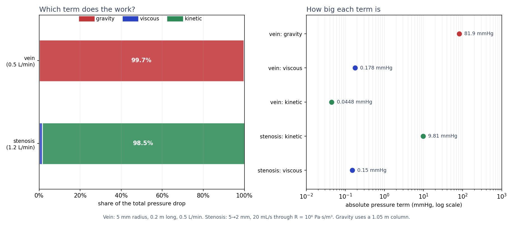
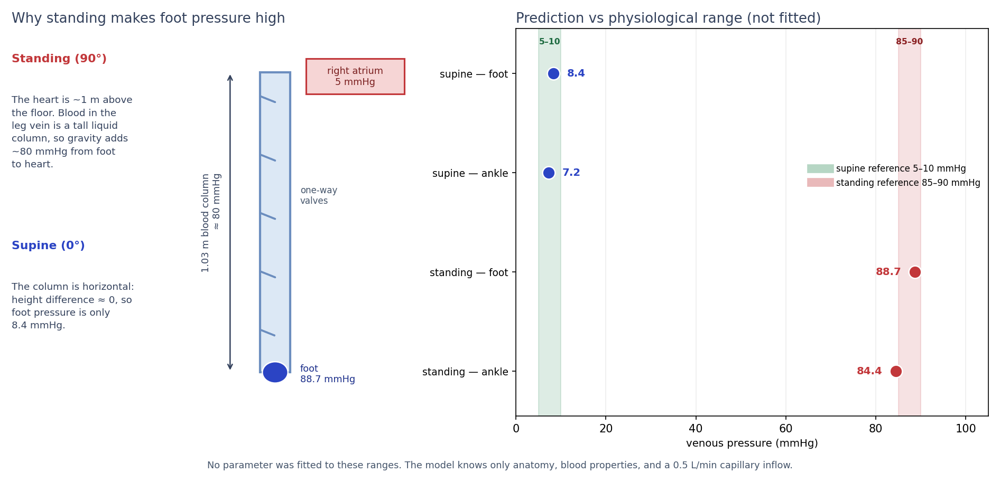
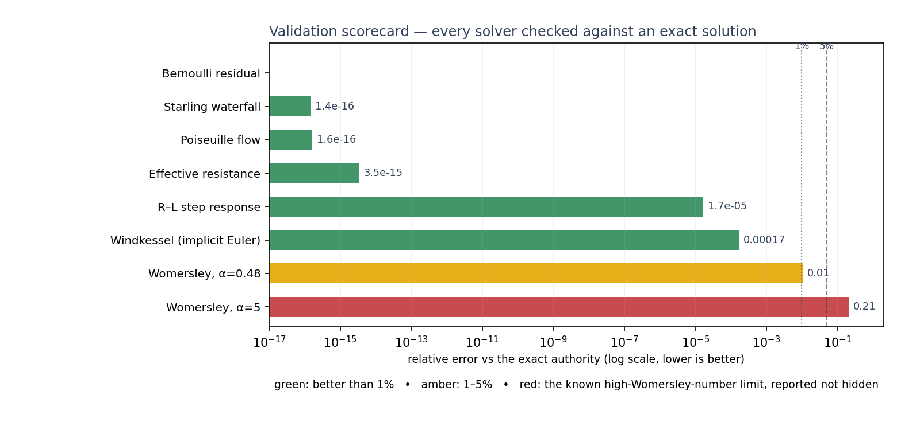

# The venous pressure result, explained simply

This is the plain-language version of the conserved-flow graph work. It assumes
you are comfortable with basic physics (pressure, flow, energy) but not with
venous physiology or lumped-parameter modeling. The precise version is in
[`bernoulli_veins.md`](bernoulli_veins.md); the measured numbers are in
[`validation_flow.json`](validation_flow.json).

## The one-paragraph version

The body's blood vessels are a plumbing network, so we represented the leg veins
as a **graph**: nodes are places blood can be (foot, ankle, calf, …), edges are
veins. Each edge carries a physical law — how hard it is to push blood through
(resistance), how much the vein stretches (compliance), how much blood mass has
to be accelerated (inertance), gravity, one-way valves, and collapse when the
vein is squeezed. Solving conservation of volume at every node plus those edge
laws predicts the pressure everywhere. With only anatomical geometry and a
0.5 L/min blood inflow — **nothing fitted to the answer** — it predicts a
standing foot venous pressure of **88.7 mmHg**, against a physiological reference
of **85–90 mmHg**. Lying down it predicts **8.4 mmHg**, against **5–10 mmHg**.

## Five ideas, in order

### 1. Pressure is not "flow"; it is the push

A graph by itself tells you what is connected. It cannot tell you *how much*
flows or *how hard the blood pushes*. For that you need a law on each edge. The
simplest is

$$
\Delta p = R\,q,
$$

which says the pressure drop $\Delta p$ across a vessel is its resistance $R$
times the flow $q$. This is the fluid version of Ohm's law, and it is exact for
slow, steady flow in a straight tube (Hagen–Poiseuille), with

$$
R = \frac{8\mu L}{\pi r^4}.
$$

The $r^4$ is the important part: halve a vessel's radius and you multiply its
resistance by 16. That is why a small stenosis matters so much.

### 2. Gravity is the whole story when you stand up

Blood is dense. A column of blood 1.05 m tall — roughly heart-to-floor in a
1.75 m person — weighs enough to add

$$
\rho g \Delta z \approx 1060 \times 9.81 \times 1.05 \approx 10{,}915\ \text{Pa}
\approx 82\ \text{mmHg}.
$$

When you lie down, that column is horizontal: the height difference between foot
and heart is nearly zero, so gravity adds almost nothing and foot venous pressure
is only a few mmHg. Standing up does not "pump" pressure into your foot; it lets
gravity do what it always does to a liquid column. This is the dominant term in
the result, and it is why the prediction is not a subtle fit — it is mostly
Archimedes.

### 3. The other terms are real but small in a vein

The full edge law in the graph is a one-dimensional momentum balance:

$$
L\dot q = p_{\text{src}} - p_{\text{dst}} - \rho g \Delta z
- Rq - \Delta p_{\text{kinetic}} - \Delta p_{\text{minor}}.
$$

The terms are:

- **Resistance** $Rq$: viscous friction. In a 5 mm vein carrying 0.5 L/min it is
  about **0.18 mmHg** per 0.2 m — tiny next to 82 mmHg of gravity.
- **Inertance** $L\dot q$: the force needed to accelerate the blood mass. Zero in
  steady flow; matters for pulses and breathing.
- **Kinetic term** $\tfrac12\rho v^2$: the "Bernoulli" term. In that same vein the
  blood moves at 0.11 m/s and the term is **0.045 mmHg** — negligible.
- **Minor losses**: extra drops from bends, branches, and stenoses.

Rearranged, this equation is exactly **extended Bernoulli**: total head
(pressure + kinetic + gravity) is conserved except for viscous and unsteady
losses. Classical Bernoulli is the special case where those losses are zero.

The figures below show the twist: in a **vein**, gravity dominates by ~460× over
viscosity and ~1,800× over the kinetic term; in a **stenosis**, the kinetic term
dominates and classical Bernoulli is almost the whole answer. One equation
handles both.



### 4. Veins are not rigid pipes

Two behaviors matter and are built into the graph:

- **Valves** allow flow only toward the heart. In the solver an edge is open
  (normal pressure–flow law) or closed (zero flow), chosen by an active-set
  complementarity loop.
- **Collapse.** A vein with low internal pressure is squeezed flat by the
  surrounding tissue. The Starling "waterfall" law says flow stops depending on
  downstream pressure once the vein is collapsed: it becomes
  $q = \max(0, (p_{\text{up}} - \max(p_{\text{down}}, p_{\text{ext}}))/R)$.
  The graph implements this and the tests check all four regimes against the
  analytic formula.

These are the parts that make a vein graph more than a resistor network.

### 5. The graph is a solver, not a metaphor

At every node, volume is conserved:

$$
C_i \dot p_i = \sum_e B_{ie} q_e + s_i,
$$

where $C_i$ is compliance (how much volume a pressure change stores), $B$ is the
oriented incidence matrix ("which edges touch this node, and in which direction"),
and $s_i$ is a source such as capillary inflow. At every edge, the momentum
balance above holds. Solve those together and you get pressures and flows
everywhere.

The lower-limb model has nine nodes and nine valved veins: foot → ankle → calf →
popliteal → femoral → iliac → IVC → right atrium, plus a superficial saphenous
path. Geometry is anatomical; posture is a rotation of the height coordinate. No
pressure was used to set a parameter.



## The result, and why it counts as a prediction

| Posture | Model foot pressure | Model ankle pressure | Physiological reference |
|---|---:|---:|---:|
| Supine (lying down) | 8.4 mmHg | 7.2 mmHg | 5–10 mmHg |
| Standing | **88.7 mmHg** | 84.4 mmHg | **85–90 mmHg** |

The reference range was consulted **after** the solve. The inputs were anatomy
(1.75 m person, heart 1.05 m above the floor, ankle 0.06 m), blood properties
(density, viscosity), and a capillary inflow of 0.5 L/min per leg. The model
predicts the hydrostatic column; it does not fit it.

The standing-minus-supine difference is 80.3 mmHg, versus the pure hydrostatic
column of 81.9 mmHg. That agreement is the point: the model recovered the
mechanism, not just the number.

## Why you should believe the solver

Every piece was checked against something that could prove it wrong and was not
used to build it:

- **Hagen–Poiseuille** for steady flow: agreement to $1.6\times10^{-16}$
  relative.
- **Windkessel** transient (a filling elastic compartment): exact matrix
  exponential agrees to 0 Pa; the implicit time-stepper converges at the
  expected first order.
- **Starling waterfall** for collapse: worst error $2.2\times10^{-19}$ m³/s.
- **R–L step response**: $1.7\times10^{-5}$ relative.
- **Extended Bernoulli** on every edge of the real vein network: max residual
  $2.0\times10^{-12}$ Pa.
- **Exact Womersley impedance** for pulsatile flow: the graph's lumped
  $R+i\omega L$ edge is within 1% up to Womersley number $\alpha=0.48$, then
  degrades predictably (4.1% at $\alpha=1$, 21% at $\alpha=5$).



The last row is deliberately red. The lumped pulsatile edge is a low-$\alpha$
model; we measured where it stops working instead of hiding it. The steady
venous prediction does not use inertance, so it is unaffected by that limit.

## What this does **not** do

- **It is steady-state.** It does not model the calf muscle pump or ambulatory
  venous pressure (the fall to ~20–30 mmHg after walking), which needs transient
  valve opening and collapse.
- **Transient valves/collapse are not implemented.** The steady solver uses
  active-set complementarity; the time-domain solver raises
  `NotImplementedError` for those edges.
- **The pulsatile edge is not a high-$\alpha$ model.** Large veins at 1 Hz have
  $\alpha\approx7$–14 and 12–18% pulsatile-impedance error. The fix is a
  frequency-domain graph solve with the exact $Z(\omega)$ on each edge — the next
  rung in [`prediction_methods.md`](prediction_methods.md).
- **Geometry is approximate.** Segment lengths and radii are order-of-magnitude
  values; the reference ranges are broad. This establishes the mechanism and the
  solver's correctness, not patient-specific accuracy.
- **No wave propagation.** A node is a lumped compliance, not a distributed tube.
  Pulse wave speed and reflections need a 1-D PDE model.

## Try it

```bash
python scripts/validate_flow.py        # regenerates the validation report and figures
python scripts/plot_flow_explainer.py  # regenerates the three charts on this page
pytest -q tests/test_flow.py           # 24 tests against exact authorities
```

The core API:

```python
from vh.graph.flow import FlowNodeSpec, VesselSpec, build_flow_graph, FlowNetwork

g, schema = build_flow_graph(nodes, vessels)
sol = FlowNetwork.from_graph(g).steady_state()
print(sol.pressure_mmhg(), sol.flow_l_min())
```

If you want the derivation, the failure modes, and the precise scope, read
[`bernoulli_veins.md`](bernoulli_veins.md). If you want to know which modeling
rung a given question needs, read [`prediction_methods.md`](prediction_methods.md).
