# Formalizing the body as a graph — and what that lets code solve

> Short answer to "if we formalize the body into a graph, can we solve problems
> with code?": **yes, for a specific and useful class of problems** — the
> structural and relational ones — and the graph also becomes the scaffold that
> wires the physics engines together and lets any part be verified on its own.
> It does **not** turn the body's quantitative, continuous core (binding,
> kinetics, folding) into something solvable by symbol-pushing; that stays
> physics. The power is the combination.

## The idea

The body is already a graph at every scale:

- **organism / organ**: compartments (organs, blood pools) joined by **blood flow**;
- **molecule**: species joined by **reactions / transport / binding**;
- **atom**: atoms joined by **bonds**.

`vh.graph` is one typed property graph for all of them. Nodes and edges carry a
`type`, a `scale`, free-form attributes, and — where it matters — the name of the
**validated computational model** behind an edge (a PBPK blood flow, a
Rodgers–Rowland partition coefficient, a quantum binding constant). So the graph
is a *map* of the system that is also partially *executable* and, crucially,
*verifiable in pieces*.

A `Schema` states what a valid formalization is: which node/edge types are legal,
what attributes they must carry, and **structural invariants** — e.g. "blood flow
is conserved at every compartment." Invariants are checked by graph algorithms,
not taken on trust.

## What graph algorithms actually answer (exactly)

Built from scratch in `vh.graph.algorithms` and demonstrated in
`scripts/validate_graph.py` on the real, validated midazolam PBPK model:

| Question | Algorithm | Result on the real model |
|---|---|---|
| Is the formalization physically consistent? | flow balance (Kirchhoff) | blood conserved at every compartment to **1.5×10⁻¹⁶** (relative) |
| Where can a drug reach? | reachability (BFS/DFS) | IV drug reaches all 14 compartments incl. brain |
| What route does an oral drug take first? | path enumeration | `gut lumen → gut → liver` — **first-pass metabolism falls out of the topology** |
| Does anything recirculate? | strongly-connected components | one loop spanning 15 compartments — the systemic circulation |
| Where are the hubs / bottlenecks? | betweenness centrality | arterial, venous, lung (all of cardiac output passes through) |
| Which organ dominates elimination? | edge analysis | liver 99% vs kidney 1% of blood clearance |

These are not approximations — they are the exact answers the graph structure
determines.

## Partial verification — "render part of it to verify it partially"

Because the formalization is compositional, any subgraph can be pulled out and
checked on its own:

- **render** any subgraph to a diagram (`vh.graph.render`, via Mermaid) and
  inspect it (`docs/img/pbpk_graph.svg`, and the elimination subgraph);
- **verify** it numerically: the elimination subgraph's total clearance equals
  the full model's clearance exactly (28.488 L/h), so that part is correct in
  isolation.



## The graph verifying the physics engine

The sharpest demonstration that the formalization is faithful: a **pure graph
algorithm reproduces part of the force field**. In molecular mechanics, the
atoms that must be excluded or down-weighted in the nonbonded sum are exactly the
1-2, 1-3 and 1-4 neighbors — i.e. atom pairs within **graph distance ≤ 3 on the
bond graph**. Running breadth-first search on the bond graph of Trp-cage and
chignolin recovers the engine's exclusion list **exactly** (1687 pairs for
Trp-cage, symmetric difference 0). A topological fact, computed by a graph
algorithm, matches the physics engine's own bookkeeping — each checks the other.

Rings (aromatic side chains, proline) show up as the cycles of the same graph;
molecules show up as its connected components.

## So, can we "solve the body with code"?

**What a graph solves, exactly:**
- structure and reachability — what connects to what, what can affect what;
- pathways and flows — routes, first-pass effects, dominant fluxes, bottlenecks;
- conservation and consistency — mass/flow balance, no orphan compartments,
  schema conformance — as checkable invariants;
- recirculation and feedback — cycles and strongly-connected components;
- composition and partial verification — check a part without the whole.

**What a graph does not solve by itself:**
- *how much / how fast / how strong* — binding free energies, reaction rates,
  folding. Those are continuous physics, answered by `vh.quantum`,
  `vh.molecular`, `vh.body`, not by topology. A graph that *claimed* to settle
  them by structure alone would be lying.

**Why the combination is the real answer.** The graph is where the scales meet:
an edge labeled `binds` carries a `Kd` that a quantum free-energy calculation
produces; an edge labeled `flow` carries a number the PBPK model validated
against clinical data; an edge labeled `clears` carries an IVIVE clearance. The
graph routes information between these models, lets each be swapped or refined
independently, checks that the whole stays consistent, and lets you verify any
piece on its own. That is a real, buildable path to "solving problems with code"
about the body — not by replacing the physics with a graph, but by giving the
physics a formal, inspectable, verifiable skeleton to hang on.

## Try it

```bash
python scripts/validate_graph.py     # runs every algorithm above, renders the diagrams
pytest -q tests/test_graph.py        # 10 tests incl. the two verifications
```
