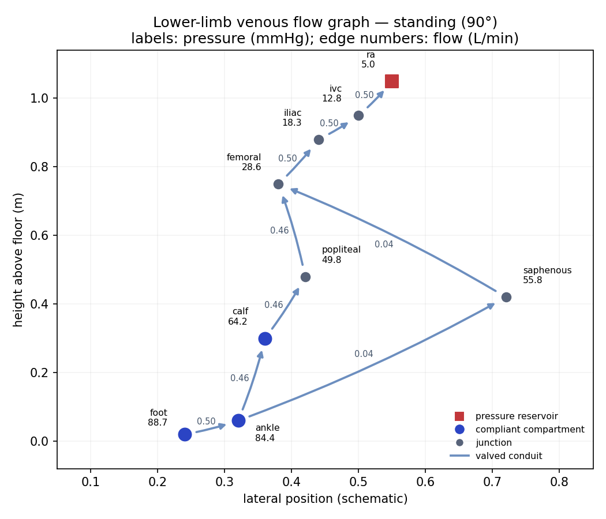
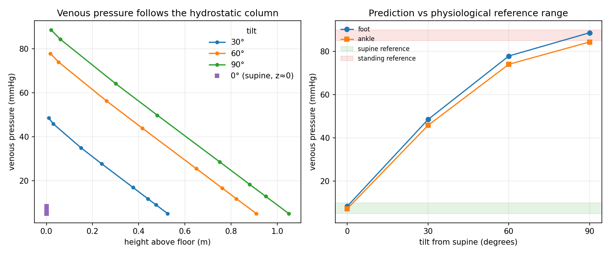
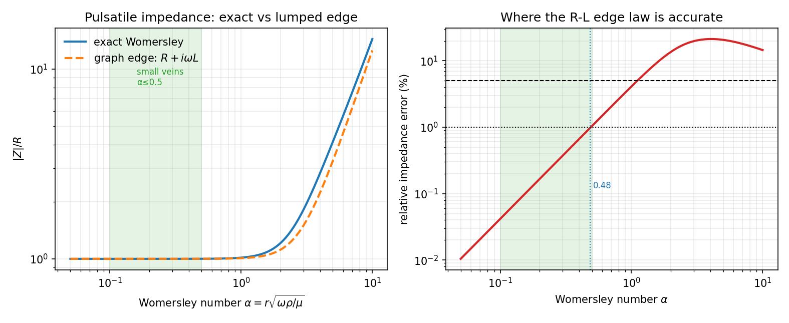

# Flow-graph validation

`vh.graph.flow` turns the typed graph into a conserved-flow solver: a lumped,
1-D Navier–Stokes model with resistance, compliance, inertance, gravity, the
Bernoulli kinetic term, Starling collapse and one-way valves. This page records
what it was checked against and the measured error. The raw numbers are in
[`validation_flow.json`](validation_flow.json); the derivation is in
[`bernoulli_veins.md`](bernoulli_veins.md).

Reproduce all of it with:

```bash
python scripts/validate_flow.py
pytest -q tests/test_flow.py
```

## What was checked

| Check | Independent authority | Measured error |
|---|---|---|
| Steady Poiseuille flow on a graph | $q=\Delta p/R$ | $1.6\times10^{-16}$ relative |
| Gravity-driven flow, 1 m column | $\rho g\Delta z/R$ | 0 absolute |
| Bernoulli stenosis | $Rq+\tfrac12\rho q^2(1/A_2^2-1/A_1^2)$ | 0 relative; residual 0 Pa |
| Starling waterfall, four regimes | $\max(0,(p_{\text{up}}-\max(p_{\text{down}},p_{\text{ext}}))/R)$ | $2.2\times10^{-19}$ m³/s max absolute |
| Series / parallel resistance | Laplacian and circuit rules | $2.3\times10^{-10}$ Pa s/m³ |
| Windkessel transient, exact solver | $qR(1-e^{-t/RC})$ | 0 Pa |
| Windkessel, implicit Euler | same | 0.169 Pa at $\Delta t=1$ ms; observed order 1.01 |
| R–L step response | $(\Delta p/R)(1-e^{-Rt/L})$ | $1.7\times10^{-5}$ relative |
| Lumped R–L vs pulsatile flow | exact Womersley $Z(\omega)$ | <1% up to $\alpha=0.48$; 4.1% at $\alpha=1$; 20.7% at $\alpha=5$ |
| Effective resistance, 0° vein network | $\Delta p/q$ vs Laplacian | $3.5\times10^{-15}$ relative |
| Extended Bernoulli on every vein edge | edge momentum balance | $2.0\times10^{-12}$ Pa max residual |
| Venous pressure, supine | physiology 5–10 mmHg | foot 8.4, ankle 7.2 mmHg |
| Venous pressure, standing | physiology 85–90 mmHg | foot **88.7**, ankle 84.4 mmHg |

The venous network has anatomical geometry (1.75 m person, right atrium 1.05 m
above the floor, ankle 0.06 m) and a 0.5 L/min capillary inflow input. **No
parameter was fitted to the pressure reference**; the reference range was used
only after the solve. The standing foot value lands inside the range, and the
supine values land inside theirs. The standing−supine difference is 80.3 mmHg,
against the hydrostatic column $\rho g\Delta z=81.9$ mmHg for 1.05 m.

## Figures

The lower-limb venous graph, with predicted pressures and flows at 90° tilt:



Pressure vs posture. The left panel shows the hydrostatic column; the right panel
shows the foot/ankle prediction against the reference bands:



The lumped edge vs the exact Womersley impedance. The venous regime
($\alpha\lesssim0.5$) is where the graph's $R+i\omega L$ edge is within 1%; the
right panel shows exactly where that stops being true:



## Limits

- The venous prediction is **steady-state**. It does not model the calf muscle
  pump or ambulatory venous pressure (~20–30 mmHg after walking).
- **Transient valve/collapse is not implemented.** The steady solver uses
  active-set complementarity; the transient solver raises `NotImplementedError`
  for these edges.
- The lumped $R+i\omega L$ edge is a **low-$\alpha$** model. At 1 Hz a 1 cm vena
  cava has $\alpha\approx13.8$ and ~11.5% pulsatile-impedance error; a 5 mm
  femoral vein has $\alpha\approx6.9$ and ~18.2%. The steady pressure result is
  unaffected because steady flow has $\omega=0$. The next rung is a
  frequency-domain graph solve with the exact $Z(\omega)$ on each edge.
- Geometry and reference ranges are broad; this establishes the mechanism and
  the solver's correctness, not patient-specific accuracy.
- Blood is Newtonian by default; at low shear the apparent viscosity is higher.
- No wave propagation: a node is a lumped compliance, not a distributed tube.

See [`prediction_methods.md`](prediction_methods.md) for the ladder from this
lumped solver to 1-D PDEs, 3-D CFD, data-driven surrogates, causal graphs, and
digital twins.
